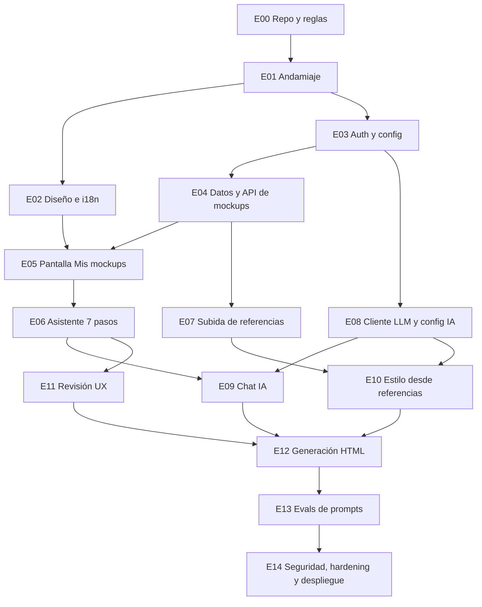

# Plan de encargos E00–E14

Cada encargo es una sesión, una rama `enc/EXX-nombre` y un PR (ver [CLAUDE.md](../../CLAUDE.md#cómo-trabajamos)). Un encargo no empieza hasta que se han fusionado todos los encargos de los que depende. Los checklists aprobados se guardan en [`checklists/`](checklists/).

| Encargo | Título | Depende de |
|---|---|---|
| E00 | Repo y reglas | — |
| E01 | Andamiaje | E00 |
| E02 | Diseño e i18n | E01 |
| E03 | Auth y config | E01 |
| E04 | Datos y API de mockups | E03 |
| E05 | Pantalla Mis mockups | E02, E04 |
| E06 | Asistente 7 pasos | E05 |
| E07 | Subida de referencias | E04 |
| E08 | Cliente LLM y config IA | E03 |
| E09 | Chat IA | E06, E08 |
| E10 | Estilo desde referencias | E07, E08 |
| E11 | Revisión UX | E06 |
| E12 | Generación HTML | E09, E10, E11 |
| E13 | Evals de prompts | E12 |
| E14 | Seguridad, hardening y despliegue | todos (E00–E13) |

E14 depende de todos los encargos anteriores. En el diagrama solo se dibuja la arista desde E13, porque E13 ya depende transitivamente de todos los demás.
